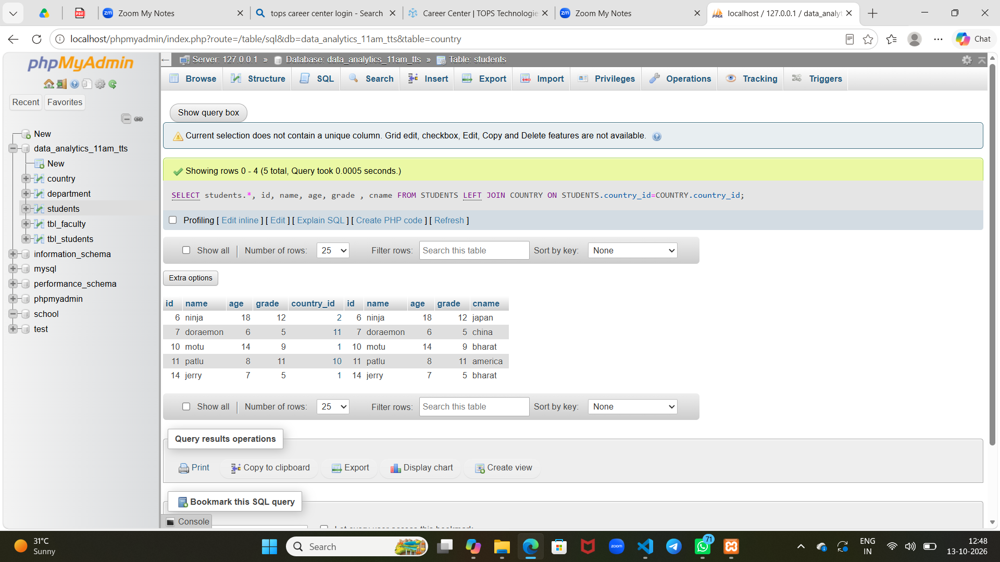

Note:mysql is not support rollback in structures*


## Home work

*students based database*

1. create a database named "school"
2. create a table named "students" with the following columns: id (primary key), name, age, grade, and country_id (foreign key referencing the country table).
3. insert at least 5 records into the students table.
4. create a table named "country" with the following columns: country_id (primary key) and country_name.
5. insert at least 3 records into the country table.
6. write a query to select all students along with their country names.
7. write a query to find the average age of students in each grade.
8. write a query to find the total number of students in each country.
9. write a query to find the student with the highest grade.
10. write a query to update the grade of a student with a specific id.
11. write a query to delete a student with a specific id.


**solutiom**

1. 
```
create database school
```
2. 

```
CREATE TABLE students (
    id INT PRIMARY KEY AUTO_INCREMENT,
    name VARCHAR(255) ,
    age INT,
    grade INT,
    country_id INT,
    FOREIGN KEY (country_id) REFERENCES country(country_id)
);
```

3.  

```
INSERT INTO students (name, age, grade, country_id)
VALUES
    ('ninja', 14, 9, 2),
    ('doraemon', 15, 10, 11),
    ('motu', 14, 9, 1),
    ('patlu', 16, 11, 10),
    ('jerry', 15, 10, 1);

    ```

4. 

```
CREATE TABLE country (
    country_id INT PRIMARY KEY AUTO_INCREMENT,
    c_name VARCHAR(255) 
);
```

5. 
```
INSERT INTO country (c_name)
VALUES
    ('bharat'), ('japan'), ('china'), (america);
```

6.
```
SELECT students.*, id, name,
 age, grade , cname
 FROM STUDENTS LEFT JOIN COUNTRY ON STUDENTS.country_id=COUNTRY.country_id

```


7. 
```
select grade, avg(age) as average_age
from students
group by grade;
```
8.
```
SELECT COUNT(student.id) AS total_students
FROM students

select students,*,cname from students JOIN country ON students.country_id = country.country_id
GROUP BY country_name;

9. 
```
select * from students where grade='A'
```


